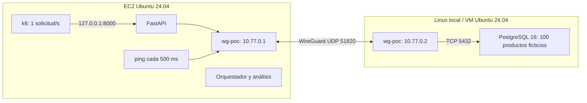

# Arquitectura híbrida: latencia e interrupciones de una VPN

**Proyecto final de Cloud Computing** — Stefano Francolino, Lucia Vazquez y Mateo Hernandez.

**Pregunta:** ¿Cómo cambia el tiempo de respuesta de una aplicación híbrida al añadir latencia entre el entorno local y AWS, y cuánto demora en recuperarse la comunicación después de una interrupción simulada?

Esta PoC mantiene una API, una base de datos y un ritmo bajo de solicitudes. Compara cuatro etapas y produce dos gráficas y un cuadro. No incluye monitoreo permanente, alta disponibilidad ni despliegue automático de AWS. Las mediciones describen **este laboratorio**, su red, sus timeouts y su aplicación; no se generalizan automáticamente a otras arquitecturas híbridas.

## Arquitectura y decisiones



- k6 corre **en EC2** y consulta por localhost. Sólo la comunicación API–PostgreSQL cruza la VPN.
- PostgreSQL se instala directamente en el host Linux para evitar redes y reglas de Docker adicionales.
- `GET /products?limit=10` consulta PostgreSQL en **cada solicitud**, con parámetro SQL `$1`, sin caché ni pool. Cada solicitud incluye el costo de abrir/autenticar una conexión nueva; varios intercambios explican que 100 ms añadidos no impliquen exactamente 100 ms adicionales en la respuesta.
- `GET /healthz` comprueba exclusivamente el proceso. Puede responder 200 durante todo el corte.
- La API usa conexión de hasta 2 s, consulta de hasta 1 s y presupuesto total de 3 s. `statement_timeout` también limita la consulta en el servidor. El cliente k6 espera hasta 4 s. Ante problemas de base de datos devuelve 503 sin filtrar detalles del error. Cierra cada conexión sin esperar tráfico adicional, no reintenta y la próxima consulta abre otra conexión.
- WireGuard usa **rutas /32** al otro extremo. No se habilita forwarding, NAT ni ruta por defecto por el túnel.
- La topología usa exclusivamente `wg-poc`, `10.77.0.1`, `10.77.0.2` y puerto 5432. Si esas direcciones se superponen con otra red, elegir otras y adaptar coherentemente API, scripts, ejemplos y HBA antes del laboratorio.

## Archivos

```text
api/main.py                 API
db/init.sql                 tabla, datos y rol de lectura
config/                     ejemplos WireGuard y PostgreSQL
load/products.js            carga constante de k6
scripts/net.py              retardo, corte, restauración y limpieza
scripts/run_experiment.py   secuencia de etapas, eventos y ping
scripts/analyze.py          CSV, Markdown y PNG
scripts/make_synthetic.py   fixture explícitamente sintético
tests/                      verificaciones de API y análisis
docs/                       grabación y validación
results/                    mediciones locales, ignoradas por Git
```

## Requisitos y preparación

Usar dos Linux Ubuntu 24.04, Python 3.12, PostgreSQL 16 y k6 1.0.0. Las dependencias Python están fijadas en `requirements.txt`; las de pruebas en `requirements-dev.txt`. Se necesita acceso `sudo`, Git, Internet para instalar y salida UDP desde el entorno local. Elegir máquinas pequeñas es suficiente; **estos archivos no crean recursos AWS ni generan cargos por sí solos**. El equipo debe preparar y administrar su EC2 por su cuenta.

En Windows se puede usar una VM Ubuntu en Hyper-V, VirtualBox o VMware, con red NAT y salida UDP. PostgreSQL y WireGuard deben estar **dentro de la misma VM Linux**. El peer local inicia el túnel hacia EC2; normalmente no se necesita redirigir puertos del router local. No usar PowerShell para los comandos de red de este README. WSL2 depende del soporte de WireGuard/netem de su kernel; una VM Ubuntu es la alternativa más predecible para la demo.

En **ambas máquinas**, clonar con una sesión autorizada para este repositorio privado:

```bash
git clone https://github.com/Stefano936/cloud-hybrid-vpn-poc.git
cd cloud-hybrid-vpn-poc
sudo apt-get update
sudo apt-get install -y wireguard-tools iproute2 iptables iputils-ping curl ca-certificates
```

En **EC2**:

```bash
sudo apt-get install -y python3-venv postgresql-client
python3 -m venv .venv
source .venv/bin/activate
python -m pip install -r requirements.txt
bash scripts/install_k6.sh
```

En **Linux local** (instancia PostgreSQL dedicada al laboratorio):

```bash
sudo apt-get install -y postgresql-16 postgresql-client-16
```

### EC2, Security Group y firewall

Usar una IP pública de EC2 que no cambie durante la demo. En el Security Group permitir TCP 22 **sólo desde la IP de administración** y UDP 51820 desde la IP pública de salida del entorno local. Si ésta cambia, actualizar la regla. Mantener la salida necesaria para instalación y respuestas; las reglas predeterminadas de salida bastan. No abrir 5432 ni 8000. La API escucha únicamente en `127.0.0.1` y se presenta desde la terminal SSH. No administrar EC2 por `wg-poc` para esta demo.

Si UFW está activo, conservar la regla de SSH y permitir UDP 51820 en EC2 desde la IP local pública. En Linux local permitir por `wg-poc` TCP 5432 desde `10.77.0.1` a `10.77.0.2`. Por ejemplo, **sólo si usan UFW**:

```bash
# EC2: sustituir el placeholder antes de ejecutar.
sudo ufw allow from <IP_PUBLICA_LOCAL> to any port 51820 proto udp
# Linux local:
sudo ufw allow in on wg-poc from 10.77.0.1 to 10.77.0.2 port 5432 proto tcp
```

Permitir ICMP echo request/reply entre los dos extremos en el firewall del host (UFW normalmente ya lo permite). No activar ni resetear firewalls durante la sesión SSH. Los scripts de experimento insertan reglas específicas antes de las de conexiones establecidas y sólo retiran sus propias reglas; no alteran políticas ni vacían cadenas.

## Configurar WireGuard (ambos hosts)

Generar una clave **diferente en cada máquina**, fuera del repositorio:

```bash
sudo install -d -m 700 /etc/wireguard
sudo sh -c 'umask 077; wg genkey > /etc/wireguard/poc-private.key; wg pubkey < /etc/wireguard/poc-private.key > /etc/wireguard/poc-public.key'
sudo cat /etc/wireguard/poc-public.key
```

Intercambiar sólo las claves **públicas**. En EC2 copiar `config/wireguard/ec2.conf.example`; en Linux local copiar `config/wireguard/local.conf.example`:

```bash
# EC2:
sudo install -m 600 config/wireguard/ec2.conf.example /etc/wireguard/wg-poc.conf
# Linux local:
sudo install -m 600 config/wireguard/local.conf.example /etc/wireguard/wg-poc.conf
```

En cada host editar `sudoedit /etc/wireguard/wg-poc.conf` y reemplazar todos los placeholders con su clave privada, la clave pública del peer y, en el local, la IP pública de EC2. Insertar la clave privada localmente, sin enviarla a chats ni guardarla en Git. No volver a generar claves en sucesivas ejecuciones si ya configuraron el par.

En **ambos hosts**:

```bash
sudo systemctl enable --now wg-quick@wg-poc
sudo wg show wg-poc
ip -4 address show dev wg-poc
```

En **local**, `ping -c 3 10.77.0.1`; en **EC2**, `ping -c 3 10.77.0.2` e `ip route get 10.77.0.2`. Esta última ruta debe usar `wg-poc`. `ip route show default` debe seguir mostrando la interfaz normal. El `PersistentKeepalive=25` del local mantiene el mapeo NAT; no es un reintento de la API ni una medición de recuperación.

## Configurar e inicializar PostgreSQL (Linux local)

Usar una instancia dedicada: el ejemplo HBA rechaza cualquier otro acceso TCP. Antes de modificar, guardar copias de los archivos originales:

```bash
sudo cp -n /etc/postgresql/16/main/postgresql.conf /etc/postgresql/16/main/postgresql.conf.pre-poc
sudo cp -n /etc/postgresql/16/main/pg_hba.conf /etc/postgresql/16/main/pg_hba.conf.pre-poc
sudoedit /etc/postgresql/16/main/postgresql.conf
```

Añadir las tres opciones de `config/postgresql.conf.example` al final del archivo. Debe escuchar únicamente en `127.0.0.1,10.77.0.2`, nunca en `*`, la IP LAN o una IP pública. Copiar el HBA restrictivo:

```bash
sudo install -o postgres -g postgres -m 640 config/pg_hba.conf.example /etc/postgresql/16/main/pg_hba.conf
sudo systemctl restart postgresql@16-main
sudo -u postgres psql -v ON_ERROR_STOP=1 < db/init.sql
sudo -u postgres psql -c '\password poc_reader'
```

El último comando pide una contraseña nueva sin guardarla en la historia ni en el SQL. Conservarla para el `.env` de EC2. El script SQL es repetible, crea 100 productos ficticios y sólo da `SELECT` al rol de la API. No contiene contraseñas.

Para garantizar el orden al reiniciar la VM, ejecutar `sudo systemctl edit postgresql@16-main` y añadir:

```ini
[Unit]
Requires=wg-quick@wg-poc.service
After=wg-quick@wg-poc.service
```

Luego `sudo systemctl daemon-reload`. Verificar:

```bash
sudo -u postgres psql -d hybrid_poc -c 'SELECT count(*) FROM products;'
sudo ss -lntp 'sport = :5432'
```

Deben aparecer 100 filas y sólo las direcciones configuradas. El HBA acepta TCP únicamente a `hybrid_poc`, usuario `poc_reader`, origen `10.77.0.1/32`, con SCRAM. La administración por socket local permanece reservada al usuario `postgres`. No abrir PostgreSQL en Internet ni en el router local.

## Configurar y ejecutar la API (EC2)

```bash
cp .env.example .env
chmod 600 .env
nano .env
```

Reemplazar `DB_PASSWORD` por la contraseña del rol; si contiene caracteres especiales, usar comillas simples conforme al formato dotenv. Mantener `DB_HOST=10.77.0.2`, puerto 5432 y los timeouts por defecto para la primera corrida. Nunca copiar `.env` a Git. No es necesario ejecutar `source .env`: la API lo lee con python-dotenv.

Antes de iniciar, verificar acceso real desde **EC2** (psql solicita la contraseña):

```bash
ping -c 3 10.77.0.2
psql 'host=10.77.0.2 port=5432 dbname=hybrid_poc user=poc_reader connect_timeout=2 sslmode=disable' -W -c 'SELECT id,name,price FROM products ORDER BY id LIMIT 3;'
source .venv/bin/activate
python -m uvicorn api.main:app --host 127.0.0.1 --port 8000 --workers 1
```

Dejar esa terminal abierta. En una **segunda terminal EC2**, desde el repositorio:

```bash
source .venv/bin/activate
curl --fail http://127.0.0.1:8000/healthz
curl --fail 'http://127.0.0.1:8000/products?limit=10'
sudo python3 scripts/net.py status
timedatectl status
```

No usar `--reload` durante las mediciones. El reloj debe estar sincronizado antes del experimento. Todas las marcas utilizadas para calcular recuperaciones se producen en **EC2**, por lo que no hay que combinar relojes de dos hosts. Si se incorporan registros de PostgreSQL o del host local, sincronizar también ese reloj mediante NTP. No cambiar manualmente la hora durante una corrida; el análisis rechaza saltos de más de 100 ms detectados entre los eventos y su reloj monotónico.

## Ejecutar las cuatro etapas (EC2)

La forma reproducible es **una única carga k6 continua**, coordinada por el orquestador. No iniciar una segunda instancia de k6 durante esta secuencia:

```bash
source .venv/bin/activate
sudo -v
python scripts/run_experiment.py \
  --normal 30 --latency 30 --outage 15 --restored 30 \
  --delay-ms 100 --rate 1 --out results/demo-01
python scripts/analyze.py results/demo-01
```

El directorio debe ser nuevo para no sobrescribir crudos. Son unos **105 segundos** más preparación y cierre. k6 programa carga por la suma de las duraciones más 1 s de margen para las transiciones y termina naturalmente. La última etapa absorbe ese margen y los costos de las órdenes: dura aproximadamente lo solicitado; puede añadir hasta 5 s de cierre de consultas en curso. Los eventos delimitan las duraciones reales. Si las transiciones acortan la última etapa más de 2 s, se rechaza la corrida. Las duraciones aceptan 5..300 s por etapa, el retardo 1..500 ms y el ritmo 1..5 solicitudes/s. `sudo -v` habilita las órdenes privilegiadas; k6 y la API se ejecutan como usuario normal. Para corridas largas renovar la credencial sudo según la política del host; si expira, la corrida falla y exige limpiar con sudo. No ejecutar dos experimentos simultáneos.

| Etapa | Operación exacta que ejecuta el orquestador en EC2 | Duración por defecto |
|---|---|---:|
| Normal | `sudo /usr/bin/python3 scripts/net.py cleanup`, preflight, inicio de k6 | 30 s |
| Latencia añadida | `sudo /usr/bin/python3 scripts/net.py delay --ms 100` | 30 s |
| VPN interrumpida | `sudo /usr/bin/python3 scripts/net.py clear-delay` y luego `sudo /usr/bin/python3 scripts/net.py block` | 15 s |
| VPN restablecida | `sudo /usr/bin/python3 scripts/net.py restore` | 30 s |
| Final | Finalización de k6 y `sudo /usr/bin/python3 scripts/net.py cleanup` | — |

Esos comandos también sirven para una comprobación manual. Para obtener marcas de recuperación e informes usar el **orquestador**, que registra el instante de cada cambio; no ejecutar las órdenes manuales mientras éste corre.

Para comprobar k6 aisladamente, sin cambios de etapa:

```bash
mkdir -p results/smoke
K6_NO_USAGE_REPORT=true RATE=1 DURATION_S=10 k6 run \
  --out json=results/smoke/k6.jsonl load/products.js
```

Esta comprobación no produce un experimento de cuatro etapas ni se procesa con `analyze.py`. k6 usa `constant-arrival-rate`, 32 VUs disponibles y 4 s de timeout para mantener el ritmo aun cuando las consultas esperan. Con el máximo de 5/s, hasta 20 solicitudes pueden esperar al mismo tiempo. Si aparecen `dropped_iterations`, repetir: no se sostuvo el ritmo elegido. No se busca saturar el sistema.

## Qué modifican los controles de red

`net.py delay` instala un qdisc `prio` y `netem` **sólo en EC2**, en el egreso de `wg-poc`. El filtro selecciona IPv4 TCP con destino `10.77.0.2:5432`. El resto va a una banda sin retardo. El valor configurado afecta **un solo sentido: EC2 → PostgreSQL**, incluidas las confirmaciones TCP en ese sentido. No se añade en el host local y no retrasa ICMP. No equivale a añadir ese valor una sola vez a una consulta completa.

El script rechaza un qdisc ajeno en esa interfaz, guarda su propiedad en `/run/cloud-hybrid-vpn-poc` y retira sólo su qdisc. En caso de conflicto no reemplaza configuraciones existentes. Las reglas `tc` y de firewall no se hacen persistentes.

`net.py block` primero quita el retardo y luego aplica `DROP` en EC2 al TCP de PostgreSQL de ese peer (ambos sentidos) y al ICMP echo de la comprobación. **Simula pérdida de conectividad de los flujos del experimento por el túnel**: no baja la interfaz, no bloquea el UDP exterior y no reinicia WireGuard. Los keepalives/handshakes pueden continuar. Por eso no debe presentarse como reinicio de VPN o medición de tiempo de handshake. SSH, otros destinos, la ruta por defecto y las reglas ajenas quedan fuera de los selectores.

`restore` retira únicamente las reglas DROP identificadas por comentario y coincidencia exacta, además de cualquier retardo propio residual. `cleanup` también realiza ambas limpiezas. Ambas operaciones son repetibles. La eliminación efectiva de varias reglas no es atómica; se registra la duración de la orden de restauración para hacer visible esa incertidumbre.

## Métricas, archivos y lectura de resultados

`results/demo-01/` contiene:

- `k6.jsonl`: salida JSON cruda de k6. `product_latency_ms` agrega una muestra por consulta, inicio y fin Unix en ms, HTTP status y éxito. La duración incluye conexión HTTP y recepción; es la observación del cliente, no sólo el tiempo SQL. Sólo HTTP 200 con un arreglo válido de 10 productos se considera éxito.
- `events.jsonl`: etapas, retiro del retardo y fin, con timestamps UTC Unix en milisegundos y reloj monotónico. Los cambios se registran al finalizar exitosamente la orden de red; también se registra el inicio de ésta.
- `probes.jsonl`: ICMP iniciado cada 500 ms, con timeout de 400 ms, inicio, fin y éxito. Bajo sobrecarga la cadencia puede degradarse; los tiempos reales quedan guardados.
- `run.json`: configuración sin secretos, versión k6 y estado de ejecución. `k6.log`: salida operativa.
- `report/summary.csv`, `summary.md`, `requests.csv`, `timeline.png`, `comparison.png`: productos del análisis.

**t0** es el timestamp inmediatamente posterior a que termina exitosamente `net.py restore`. Las reglas se retiraron durante la ventana que comienza en `operation_started_ms`. Las métricas incluyen planificación del proceso y resolución del muestreo; no son tiempos internos de WireGuard:

1. **Recuperación de conectividad:** primera comprobación ICMP exitosa que finaliza desde t0, menos t0. Resolución aproximada de 500 ms, más RTT y planificación del host (timeout por intento 400 ms).
2. **Recuperación de aplicación:** primera consulta k6 a productos exitosa que finaliza desde t0, menos t0. Resolución de aproximadamente `1 / rate` segundos más la duración de la consulta. Puede ser una consulta iniciada antes de t0 y completada después. No se agrega un generador adicional de consultas.

La API y ping son independientes. Una recuperación menor que la resolución de muestreo no demuestra precisión submilisegundo. Para declarar recuperación debe haberse observado al menos una falla del mecanismo correspondiente durante el corte; sin evidencia del corte, o sin éxito antes del fin, se muestra **N/A**, no cero. La restauración no elimina retrasos naturales ni retransmisiones ya pendientes.

Las solicitudes se asignan a la etapa de su **inicio**. Las que terminan en otra etapa quedan marcadas `crosses_phase` en `requests.csv`; pueden existir consultas en curso durante transiciones. El pequeño intervalo entre quitar retardo y completar el bloqueo todavía pertenece a la etapa anterior por esta convención. Las marcas crudas permiten inspeccionarlo. La media y p95 usan exclusivamente éxitos; timeouts, 503 y respuestas inválidas se cuentan como fallas y aparecen aparte en la serie temporal.

El resumen global que k6 imprime en su consola puede agregar duraciones de solicitudes exitosas y fallidas. **No usar ese promedio global como comparación de latencia**: usar `report/summary.csv` y `comparison.png`, que separan explícitamente los éxitos. `k6.log` se conserva para diagnóstico.

p95 usa interpolación lineal y se informa sólo con **20 o más éxitos** en la etapa; con menos se muestra N/A. Es una descripción de pocas muestras, no una estimación robusta de producción. En el corte normalmente no habrá éxitos: media y p95 serán N/A. Los tiempos de recuperación sólo corresponden a la fila «VPN restablecida». Un informe con iteraciones descartadas debe repetirse. Una corrida incompleta se conserva pero no genera un cuadro válido.

Comparar normal frente a latencia añadida; luego comprobar que la etapa restablecida vuelve aproximadamente a la referencia. No exigir un incremento exacto igual al retardo ni prometer un tiempo de recuperación. Repetir dos o tres veces si desean mostrar variabilidad, con los mismos parámetros, sin combinar archivos de corridas diferentes.

## Pruebas y datos sintéticos

```bash
source .venv/bin/activate
python -m pip install -r requirements-dev.txt
python -m pytest -q
python -m compileall -q api scripts
python scripts/make_synthetic.py
python scripts/analyze.py examples/synthetic/output
```

Los datos sintéticos sólo prueban procesamiento y gráficas, están separados de `results/` y llevan una marca explícita. No son resultados esperados ni evidencia experimental. [Validación y límites](docs/VALIDATION.md) detalla las comprobaciones realizadas. [Guion de grabación](docs/DEMO.md) propone una presentación de pocos minutos.

## Limpieza y recuperación manual

En **EC2**, incluso después de Ctrl+C o un error:

```bash
sudo /usr/bin/python3 scripts/net.py cleanup
sudo /usr/bin/python3 scripts/net.py status
ping -c 3 10.77.0.2
curl --fail 'http://127.0.0.1:8000/products?limit=10'
```

El orquestador intenta limpiar en `finally` ante errores, Ctrl+C y SIGTERM. Un SIGKILL, una caída del host o pérdida de sudo puede impedirlo: ejecutar la limpieza manual con credenciales renovadas. No usar `iptables -F`, `nft flush ruleset` ni borrar qdiscs de otras interfaces. Si se detecta un qdisc ajeno, inspeccionar con `sudo tc -s qdisc show dev wg-poc`; no eliminarlo a ciegas. En reinicio se pierden las reglas temporales y la marca en `/run`.

Para finalizar el laboratorio, detener la API con Ctrl+C. En **Linux local**, detener PostgreSQL antes de bajar WireGuard: `sudo systemctl stop postgresql@16-main`. En **ambos hosts**, `sudo systemctl disable --now wg-quick@wg-poc`. Si se desea revertir PostgreSQL, restaurar las copias `.pre-poc` y retirar únicamente el override de orden creado para este laboratorio; no borrar otros overrides. El equipo debe detener o terminar EC2 cuando corresponda y revisar por su cuenta cargos de volúmenes/IPs. Conservar los crudos y el video fuera del repositorio antes de destruir una VM.

## Problemas frecuentes

| Problema | Comprobación |
|---|---|
| No hay handshake ni ping | Claves, endpoint público, UDP 51820 en Security Group, salida UDP local, `sudo wg show`. Desde local iniciar un ping; revisar NAT y keepalive. |
| Hay handshake pero no ping | Revisar las rutas /32, direcciones, reglas ICMP y `net.py cleanup`. Un handshake no prueba acceso a PostgreSQL. |
| Ping funciona, API da 503 | Probar psql desde EC2; revisar contraseña, HBA, servicio PostgreSQL y direcciones de escucha. El cuerpo 503 deliberadamente no revela credenciales. |
| PostgreSQL no inicia tras reiniciar | Levantar `wg-poc` antes de PostgreSQL y configurar el override de systemd. |
| `RTNETLINK`/netem no soportado | Usar Ubuntu con módulo `sch_netem` (`sudo modprobe sch_netem`); en kernels AWS puede requerir `linux-modules-extra-$(uname -r)`. Preferir VM Linux completa si WSL no lo soporta. |
| Se pierde el ritmo k6 | Revisar `dropped_iterations`, CPU y otros procesos; mantener 1/s y repetir. No interpretar la corrida como comparable. |
| No aparecen recuperaciones | Revisar crudos, prueba ICMP previa y ventana restablecida. N/A no equivale a recuperación instantánea. |
| `.env` no se aplica | Ejecutar desde la raíz del repositorio, comprobar nombre del archivo y reiniciar la API después de cambiar configuración. |
| Informe rechaza corrida | Revisar `run.json`, `k6.log`, permisos sudo, archivos JSON truncados o cambio de hora. Conservar la corrida y repetir en otro directorio. |

## Referencias técnicas

El túnel dividido y keepalive siguen la [guía oficial de WireGuard](https://www.wireguard.com/quickstart/). El generador usa el [ejecutor constant-arrival-rate](https://grafana.com/docs/k6/latest/using-k6/scenarios/executors/constant-arrival-rate/) y la [salida JSON de k6](https://grafana.com/docs/k6/latest/results-output/real-time/json/). El retardo usa [tc-netem](https://man7.org/linux/man-pages/man8/tc-netem.8.html). Para revisar reglas de autenticación consultar [pg_hba.conf de PostgreSQL 16](https://www.postgresql.org/docs/16/auth-pg-hba-conf.html).
